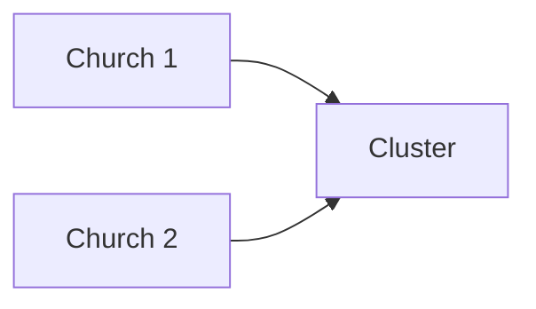

# Guide Writing Conventions

Rules for writing course guides (content in `resources/{lang}/{course}/`).

## The Five Pillars (from PRINCIPLES.md)

1. **Focus** — One clear learning objective per guide. No digressions.
2. **Brevity** — 400-700 words, completable in 5-7 minutes. The count is a guide,
   not a hard limit: one objective and a single short session matter more.
   3-5 comprehension questions.
3. **Action** — Knowledge that leads to a tangible action or applicable skill.
4. **Joyful Engagement** — Interactive, game-like. Learning as delightful
   discovery.
5. **Accessible Tone** — Informal, relational, humorous. No sterile formality.

## Comprehension Questions

- Write **8 or more questions** per guide (recommended: 8-10). The crossword
  takes **at most 5 clues per puzzle** (`apps/web/app/api/crossword/route.ts`
  samples the guide's bank), so the size of the bank decides how much a retake
  varies: 5 questions give always the same puzzle, 6 give 6 combinations, 8 give
  56 and 12 give 792.
- The learner solves **at most 5 words** per attempt (from PRINCIPLES.md:
  3-5 per session, not a heavy burden).
- Each question includes a blank `___` and is followed by the expected answer 
  in parentheses: `(answer)`. Answers are case-insensitive and 
  accent-insensitive — the system normalizes both before comparison 
  (`packages/rewards/src/lib/
  normalize-answer.ts`): `pais` matches `país` and `ensena` matches `enseña`. 
  Write the answer with its correct spelling; the learner may type it 
  without the accent or the ñ.
- The answer in parentheses is what the crossword system uses to validate.
- **The parenthesis is also the offline contract** (R-#256): when a learner 
  solves a downloaded crossword and submits it after reconnecting, the 
  server derives the expected answers from this markdown, matching each 
  clue (the question text) with its answer. Keep one question per numbered 
  item (a question may wrap to the next line),
  keep `___` in the body and the answer in the **last** parentheses of the 
  item, and do not put a `)` inside the answer: a guide that breaks the 
  format makes its crossword unverifiable offline.
- Never put instructions or extra text inside the parentheses — they are
  reserved for the answer only. Put instructions in the question body.
- Use words, not digits: `(onehundred)` not `(100)`. Join compound words:
  `(SierraLeona)`, `(twentyfour)` not `(twenty-four)` or `(twenty four)`. 
- Avoid technical jargon in questions. Instead of "With V4, partial payments
  are supported", say "The contract that pays scholarships allows receiving
  only one reward if funds are low — this is a ___ payment."

## Format

- Markdown files in `resources/{lang}/{prefijoRuta}/`.
- Filename matches `sufijoRuta` in the database (e.g., `guide1.md`,
  `guia2.md`).
- English content in `resources/en/`, Spanish in `resources/es/`.
- Keep both language versions synchronized.
- Some courses live in a private repository mounted as a git submodule
  (`resources/en/gdcluster` for the Global Disciples EN course, `resources/es/redgd`
  for the ES one); clone with `--recurse-submodules` to get their guides.
- Cross-reference the other guides of the course with a relative link
  (`[Guide 3](../guide3)`); pages outside the course with an absolute path
  (`/en/migration-in-app-wallet`).
- Guide URLs (`/{lang}/{prefijoRuta}/{sufijoRuta}`) are hardcoded in a few places
  (`GasInsufficientPanel`, `donation-target`, the cluster and referral pages, the E2E
  specs): renumbering a guide means updating those references too.

## Diagrams

The diagram is written **inside the guide**, as a fenced Mermaid block; the text after `mermaid`
is the alt text (if left empty, the nearest heading above it is used):

````markdown

````

The renderer (`apps/web/lib/remarkMermaid.mjs`, already wired into `guideProcessor`) turns that
block into `.svg" alt="…">`. Three properties follow from that
design, and they are the reason it is an image and not inline SVG:

- the page ships **no Mermaid runtime** (the guide HTML is also built in the browser, where
  `mermaid` is tens of megabytes and a flowchart takes seconds);
- it survives `allowDangerousHtml: false` (the course page renders with it) and
  `guideImageUrls` caches the `` for **offline reading**;
- the source stays next to the paragraph that explains it, instead of in a separate folder.

The SVG is generated **before the commit**, never by hand and never at request time. The file name
is a hash of the source, so editing a diagram produces a new file and the old one is deleted:

```sh
cd apps/web
node bin/mmd2svg.mjs --scan ../../resources --out public/img/diagrams --theme neutral
```

- `@speajus/mermaid-to-svg` renders in Node (`mermaid` + `elkjs` + `react-dom/server`, text measured
  with jsdom): **no browser needed**, and it works on OpenBSD/adJ (measured 2026-11-15: flowchart
  2–6 s, sequence < 100 ms).
- Themes: `default`, `dark`, `forest`, `neutral`; use `neutral` for the guides so it matches the
  page. Existing SVGs are skipped unless `--force` (needed after changing the theme).
- Commit the guide **and** the generated SVG: the guide is the source, the SVG the artifact the app
  serves and the service worker caches.
- The last line of the scan (`N diagramas: X generados, Y ya existían, Z borrados`) is the summary;
  a failure exits non-zero and names the `guide:line`.
- `apps/web/lib/__tests__/guides-consistency.test.ts` fails when a diagram has no SVG generated or
  no alt text, so a forgotten scan is caught before the commit.
- `make all` and `make prod` run it (target `make diagrams`, after `pnpm i`): with nothing new it
  costs ~0.3 s and the renderer is not even imported, so a diagram added to a guide always reaches
  the build with its SVG.
- A standalone `.mmd` still works (`node bin/mmd2svg.mjs diagrama.mmd salida.svg`), for diagrams
  outside a guide.

## Database

- Each guide is a row in `cor1440_gen_actividadpf` linked to a course via
  `proyectofinanciero_id`.
- `nombrecorto` controls ordering (text sort). **Always plain numbers** (`guide1`,
  `guide2`, `guia3`…): to insert a guide in the middle, **renumber the ones that
  follow** (`guide2b` was the old letter-suffix convention and is no longer used).
- `sufijoRuta` must match the filename without extension.
- To add a guide between existing ones, use a migration (`bin/m db:mig:make`).
  See [How to Create a Course](how-to-create-a-course.md) for the full course
  setup workflow (script, DB, vault, credentials).
